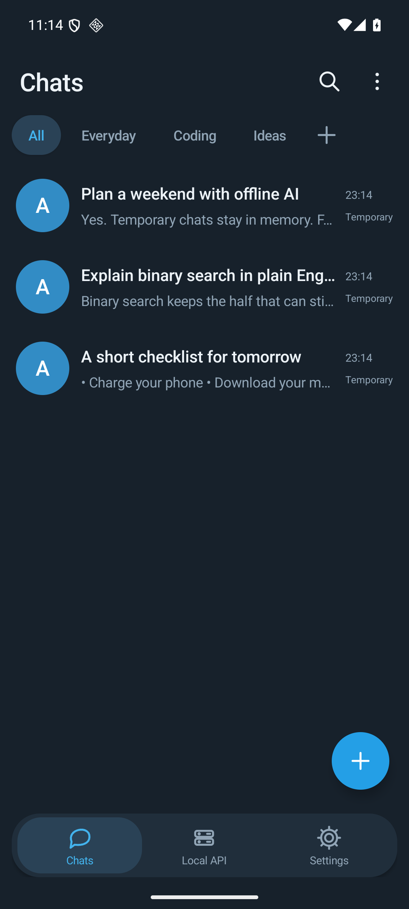
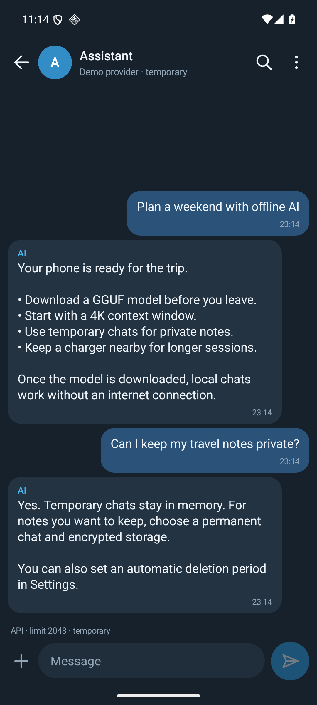
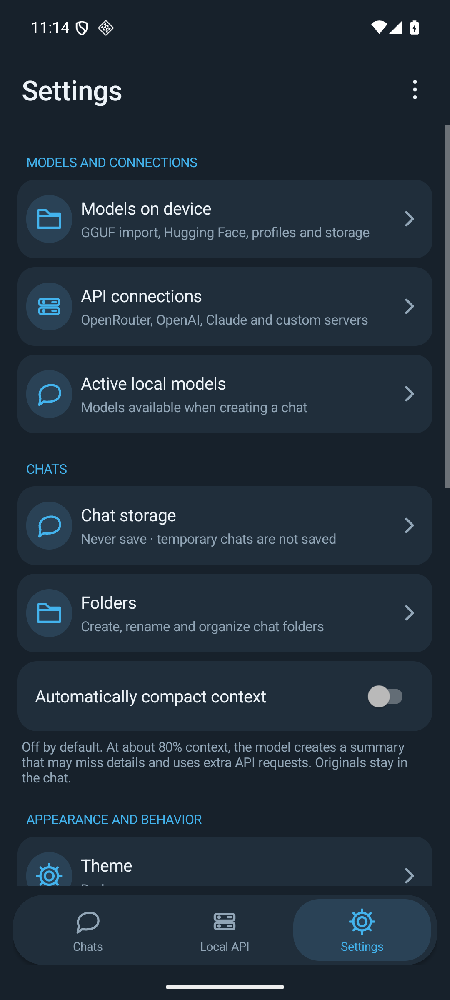
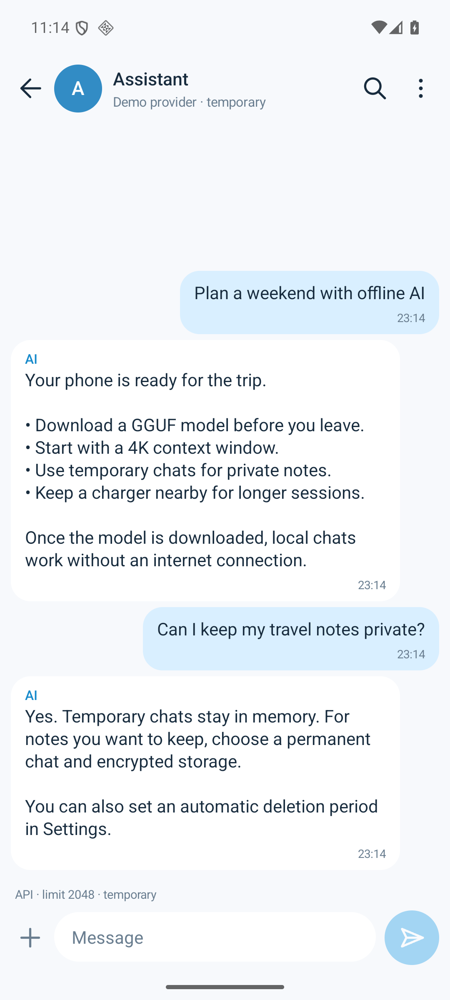
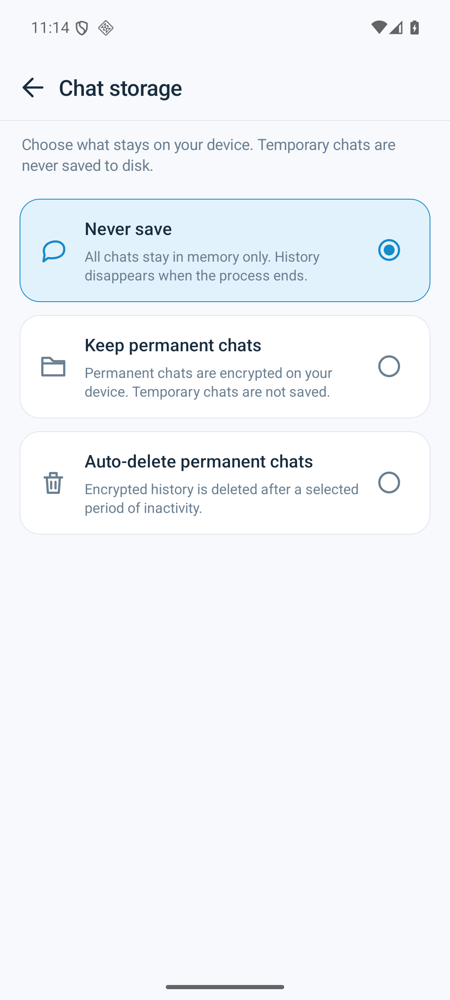
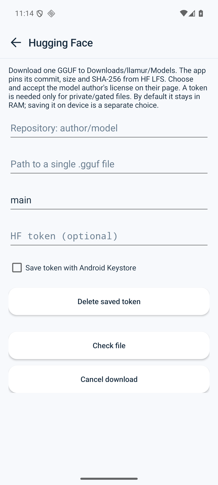

<p align="center"></p>
<h1 align="center">llamur</h1>
<p align="center"><strong>Ваши модели. Ваш телефон. Ваши диалоги.</strong><br>Локальный запуск GGUF, чат в стиле мессенджера и OpenAI-совместимый сервер на Android.</p>
<p align="center"><a href="README.md">English</a> · <strong>Русский</strong> · <a href="docs/providers.md">Провайдеры</a> · <a href="docs/api.md">API и Aider</a> · <a href="docs/build.md">Сборка</a></p>

Запускайте скачанную модель без облачного аккаунта, root и Termux. Раскладывайте
диалоги по папкам, оставляйте личную переписку временной, получайте ответы при
свёрнутом приложении и подключайте инструменты на компьютере к модели на телефоне.
В том же интерфейсе доступны OpenRouter, OpenAI, Claude и собственные совместимые серверы.

**В основе — доработанный llama.cpp с приоритетом качества:** исходные GGUF-веса,
квантизация и F16 KV сохраняются. В движке исправлены исследованные численные и
модельные особенности, доработано управление памятью, есть отмена инференса и
необязательная ограниченная упаковка вычислений prefill.

Предварительная версия · Android 9+ · ARM64 · English / Русский · Приложение Apache-2.0.
Подготовка к F-Droid есть в проекте; в каталоге F-Droid приложение пока не опубликовано.

## Настоящее Android-приложение

<table>
<tr><td align="center"><br>Диалоги и папки</td><td align="center"><br>Переписка</td><td align="center"><br>Модели и настройки</td></tr>
<tr><td align="center"><br>Светлая тема</td><td align="center"><br>Ваш режим хранения</td><td align="center"><br>Свои модели</td></tr>
</table>

Это реальные снимки запущенного приложения на ARM64-эмуляторе Android API 36,
с английским UI и открытыми демонстрационными диалогами. Они показывают интерфейс,
а не результаты конкретной модели; макеты не использовались.
[Как сделаны снимки](docs/screenshots/README.md).

## Возможности

- **Локальный чат без сети.** Импорт GGUF, подключение поддержанного файла на
  устройстве или загрузка с Hugging Face. Отдельные контекст и резерв ответа для модели.
- **Привычный мессенджер.** Поиск диалогов, папки, поиск по сообщениям, закрепления,
  информация о модели, потоковые ответы и кнопка отправки/остановки. Светлая,
  тёмная и системная тема.
- **Ответы в фоне.** Задайте вопрос, сверните приложение и вернитесь через
  уведомление. Ограничения энергосбережения Android продолжают действовать;
  текст переписки в уведомление не попадает.
- **Управляемая история.** По умолчанию ничего не сохраняется; временные диалоги
  живут в RAM. Для постоянных есть шифрованное хранилище и автоудаление.
- **Ручной и автоматический компакт.** Автоматический режим включается отдельно,
  по умолчанию выключен. Сводку можно просмотреть, применить и отменить. Исходные
  сообщения следуют режиму хранения чата. Пересказ может упускать детали.
- **Облачные и собственные API.** OpenRouter, OpenAI Chat Completions/Responses,
  Anthropic Messages и совместимые endpoint: каталог моделей, несколько
  подключений, настройки провайдера, защищённые credentials и явное согласие на HTTP.
- **Вложения по возможностям провайдера.** Текстовые файлы, изображения и PDF;
  поддержанные ответные файлы и изображения можно сохранить из чата. Локальный
  GGUF-чат пока текстовый.
- **Телефон как API-сервер.** `/v1/models`, `/v1/chat/completions`, streaming,
  usage и отмена. Loopback защищён Bearer-токеном, Wi-Fi — TLS и Bearer.
  Aider выполнил две реальные правки кода через телефон.
  [Подключение и поддержанный subset](docs/api.md).
- **Удобное хранение моделей.** `Downloads/llamur/Models` на Android 10+,
  проверка целостности, продолжение/отмена загрузки, обнаружение дубликатов и
  отдельное предложение удалить исходник после проверки импортированной копии.

Локальный чат не переключается в облако скрыто. API-ключей в приложении нет.
Для публичных HF-репозиториев токен необязателен, для закрытых и gated действуют
правила доступа самого репозитория. [Политика приватности](docs/privacy-policy.md).

## Отличия от стокового llama.cpp

Сравниваем с **Android-примером закреплённой версии upstream**, коммит
[`701fd25`](https://github.com/ggml-org/llama.cpp/tree/701fd25b3a55a90297dec0d925204b29084054c8/examples/llama.android),
и отдельными сопоставимыми экспериментами native-пути. Это не сравнение со всеми
оболочками llama.cpp и не утверждение о будущих версиях upstream.

| Область | Закреплённый Android-пример / неисправленный путь | llamur |
| --- | --- | --- |
| Шаблоны проверенных моделей | Gemma аварийно завершалась на custom template при выключенном Jinja | Полный Jinja и явные проверки шаблона/токенов |
| Представление весов | Некоторые включённые backend-пути преобразуют дополнительные weight buffers | Исходная квантизация GGUF; нарушающие политику преобразования исключены |
| Attention и состояние | Исследованные расхождения округления, порядка редукции и длинной суммы | Исправления F32/recurrent, стабильное разбиение decode-редукции и накопление длинного attention |
| Загрузка и память | Ранний профиль примера с Ornith завершался Android LOW_MEMORY | Native mmap без полного prefault, проверка бюджета модели/контекста/workspace и один владелец движка |
| Обработка контекста | Пример обрезает/сдвигает вход | Явный бюджет контекста и ответа, ошибка переполнения, видимый и отменяемый компакт |
| Отмена и жизненный цикл | Prompt processing в примере помечен как непрерываемый | Prefill по частям, native abort, отдельный процесс, восстановление и завершение в фоне |
| Вычисления prefill | Native quantized matmul | Необязательная ограниченная lossless-упаковка workspace без постоянной полной второй копии весов |
| Повседневное использование | Демонстрационный интерфейс | Диалоги, папки, хранение, загрузки, провайдеры, уведомления и локальный API |

Работа с памятью устраняет исследованные сценарии неудачной загрузки, но не
исключает LOW_MEMORY при любом давлении Android и не делает длинный prefill быстрым.
Vulkan/OpenCL-кандидаты, не прошедшие качество или стабильность, в продуктовый
профиль не включены. Консервативный default — CPU4.
[Совместимость](docs/compatibility.md) · [Серия патчей](patches/cpu-numeric/series.json).

## Реальные измерения скорости

Все телефонные результаты ниже получены на **Motorola Edge 40 Pro, Snapdragon
8 Gen 2, 12 ГБ RAM, Android 16**, с исходными закреплёнными Q4_K_M и F16 KV.

### Подтверждённый выигрыш prefill

Контролируемый эксперимент с Ornith и входом 512 токенов сравнил native-путь с
ограниченной упаковкой workspace. Один прогрев исключён, затем пять пар с
чередованием порядка: CPU4, batch 512 / micro-batch 128, окно 8K, прогретая модель.

| Ornith 1.5 9B | Native-путь | Экспериментальная упаковка |
| --- | ---: | ---: |
| Медианное время prefill | 82,58 с | 49,57 с |
| Входных токенов в секунду | 6,20 | 10,33 |
| От запроса к первому фрагменту при загруженной модели | 82,65 с | 49,64 с |

**Медианное парное ускорение prefill 1,65×**, bootstrap-интервал 95% —
1,62–1,68×. Это примерно **на 40% меньше ожидания prefill** в данном эксперименте.
Исходные веса и F16 KV не менялись; наблюдаемый workspace — около 41 МиБ,
резерв при допуске — 81 МиБ. Настройка экспериментальная и **выключена по умолчанию**.

Результат относится к тому development APK и короткому прогретому prefill.
Это не универсальное ускорение текущего релиза, не холодная загрузка и не decode.
Сопоставимого принятого ускорения Gemma «до/после» пока нет. Отбракованные и
смешанные по частотам серии сохранены, но не рекламируются как выигрыш.
[Парные замеры и методика](docs/benchmarks/README.md).

### Короткие запросы через приложение

Более позднее наблюдение B/P/P/B использовало один движок, CPU4, загруженную
модель, контекст 4K, выключенные packing/cache, 30–31 входной и 128 выходных
токенов. Для двух измеренных запросов через UI на модель получились средние:

| Проверенная модель | Полное время запроса через UI | Скорость backend decode |
| --- | ---: | ---: |
| Ornith 1.5 9B Q4_K_M | 35,5 с | 4,2 токена/с |
| Gemma 4 E4B-it Q4_K_M | 22,8 с | 6,5 токена/с |

Из-за бюджета это **частичные ответы с остановкой по длине**, включая reasoning,
а не время полноценного ответа. Decode считает 127 вычислений для 128 выданных
токенов. Две пары не подтверждают устойчивую длительную скорость или p95.
Медианное отношение полного времени UI к harness того же движка — около 1,016
для Ornith и 1,021 для Gemma: небольшие наблюдаемые накладные расходы интерфейса,
а не ускорение относительно стока. [Исходные строки](docs/benchmarks/short-ui-requests.json).

**Большой контекст есть, но он медленный.** По умолчанию 4K, доступны точки
2/4/8/16/32K. Обе модели прошли по одному заполненному ordered-retrieval контролю
на 16K и 32K с экспериментальной упаковкой. На 32K prefill занял около
**101,5 минуты у Ornith** и **76,4 минуты у Gemma**. Это проверка совместимости
и конкретного ответа, не интерактивный режим и не гарантия качества любых
длинных диалогов. [Полные результаты и ограничения](docs/performance.md).

## Проверенные модели

| Точный GGUF | Архитектура | Размер | Что проверено |
| --- | --- | ---: | --- |
| [Ornith-1.5-9B-Q4_K_M](https://huggingface.co/ornith-ai/Ornith-1.5-9B-GGUF) | `qwen35` | 5,38 ГиБ | Численные/scored контроли, завершённый код, retrieval, API/Aider, фон и восстановление |
| [gemma-4-E4B-it-Q4_K_M](https://huggingface.co/unsloth/gemma-4-E4B-it-GGUF) | `gemma4` | 4,64 ГиБ | Численные/scored контроли, завершённый код, retrieval, фон и восстановление |

Точные revision, SHA-256, хеши tokenizer/template и происхождение лицензий моделей
есть в [models.lock.json](bench/models.lock.json). Веса скачиваются отдельно.
Маленькая `stories260K` — тестовый fixture, её скорость не относится к основным моделям.
Проверка Ornith не сертифицирует всё семейство Qwen; у Gemma свои пути attention/state.
Другие GGUF могут работать, но тот же набор проверок для них не проводился.

## Устройства и требования

**Нижняя граница сборки:** Android 9 / API 28+, 64-битная ARM64 ОС. Для двух
моделей выше разумная отправная точка — **12 ГБ RAM или больше и быстрый накопитель**.
Сами файлы вместе занимают около 10 ГиБ, дополнительно нужна память движка и Android.
Меньшие модели могут помещаться на устройствах с меньшей RAM, но 6/8 ГБ не прошли
эту квалификацию.

| Устройство / платформа | Статус |
| --- | --- |
| Motorola Edge 40 Pro · Snapdragon 8 Gen 2 · 12 ГБ · Android 16 | Физические проверки инференса, качества, жизненного цикла, API и фона |
| ARM64-эмулятор Android 16 · API 36 · реальные страницы 16 КиБ | UI, IPC, хранилище, языки/темы, жизненный цикл и совместимость страниц памяти; не скорость второго телефона |

**Вероятные кандидаты, ещё не проверены:** [Galaxy S23 Ultra, вариант 12 ГБ](https://www.samsungmobilepress.com/media-assets/galaxy-s23-ultra?tab=specs),
[Galaxy S24 Ultra, 12 ГБ](https://news.samsung.com/us/enter-new-era-of-mobile-ai-samsung-galaxy-s24-series/),
[OnePlus 11, вариант 16 ГБ](https://www.oneplus.in/11/specs) и
[Xperia 1 V, 12 ГБ](https://www.sony.com/electronics/support/mobile-phones-tablets-mobile-phones/xperia-1-v-256gb/specifications).
Это предположение по железу: объём RAM и Snapdragon 8 Gen 2/3 делают их разумными
кандидатами для CPU-инференса, но скорость на них не измерялась. Другие Snapdragon,
Exynos и MediaTek требуют отдельных проверок. Важны охлаждение, свободная RAM,
прошивка и энергосбережение, а не только марка телефона или слово «флагман».

## Сборка и участие

```sh
git clone https://github.com/gordeev/llamur.git
cd llamur
bash scripts/fetch-upstream.sh
```

Нужны JDK 17, Android SDK/API 36, стабильный NDK r28c (`28.2.13676358`) и Android
CMake 3.31.6. Следуйте [настройке Android](docs/build.md) и
[инструкции release-сборки](docs/release-build.md). Locks и patch series фиксируют
исходный upstream и toolchain. Загруженные инструменты, веса, credentials,
локальные инструкции агентов и результаты сборки исключены из Git.

Ошибки: [GitHub Issues](https://github.com/gordeev/llamur/issues). Полезны версия
приложения, телефон/SoC/RAM, версия Android, файл модели и квант, контекст и
обезличенная диагностика. Ключи и приватные диалоги прикладывать не нужно.

[Apache-2.0](LICENSE) относится к приложению; notices зависимостей включены.
У моделей собственные лицензии. [Приватность](docs/privacy-policy.md) ·
[Подготовка F-Droid](docs/fdroid.md) · [Измерения](docs/performance.md).
